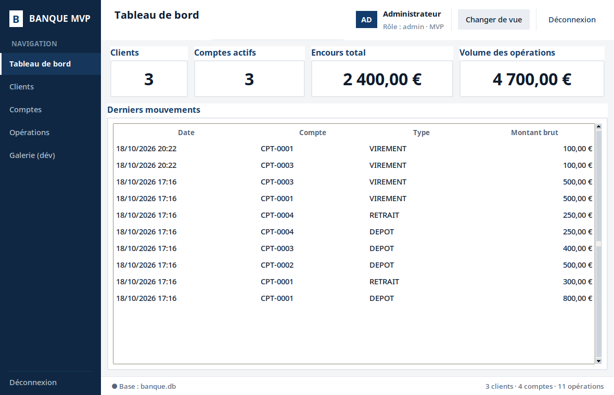
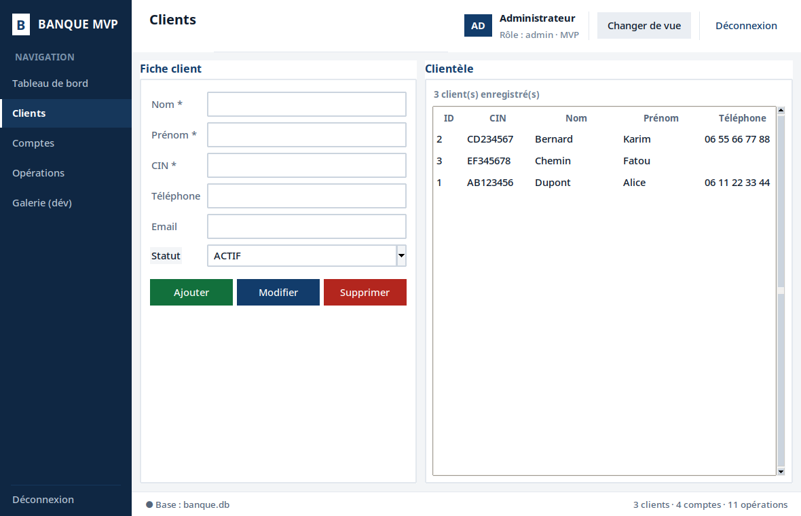
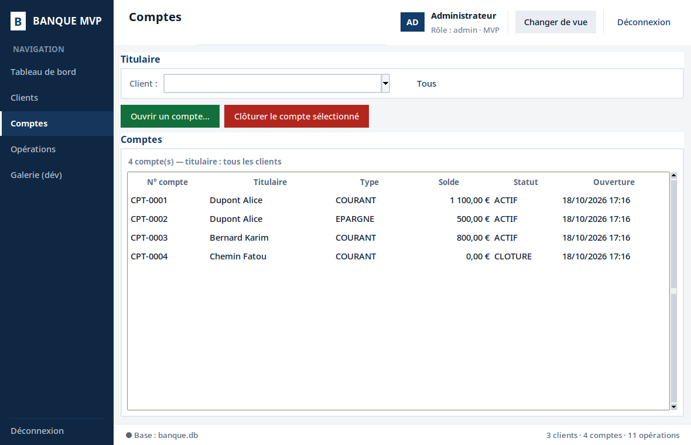
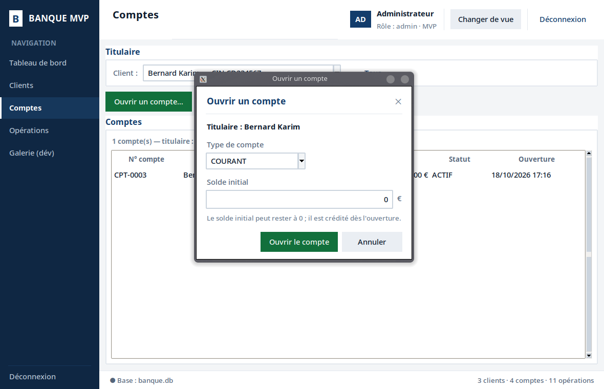
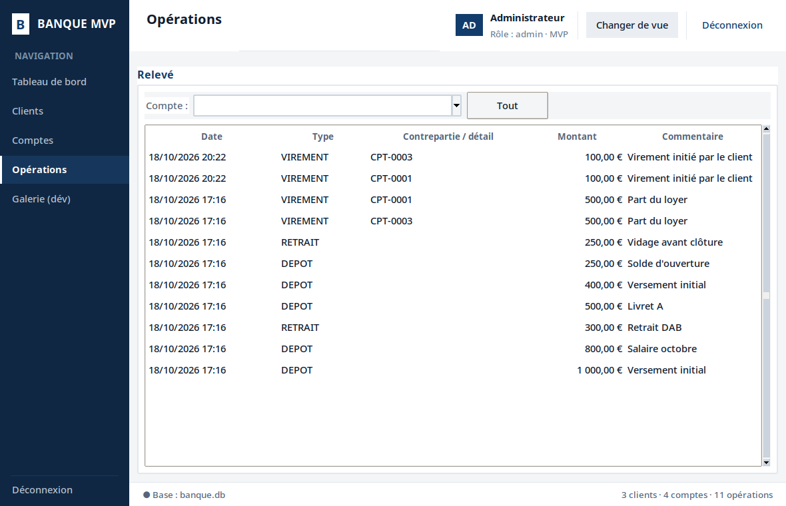
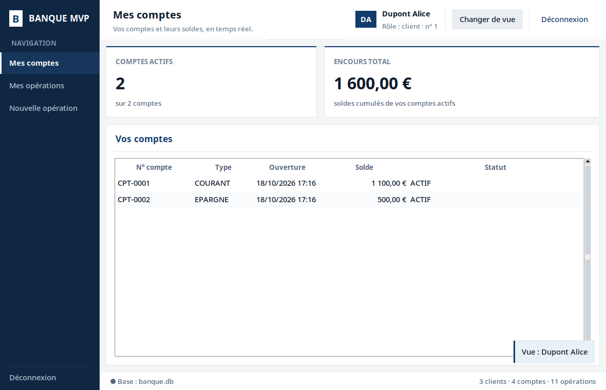
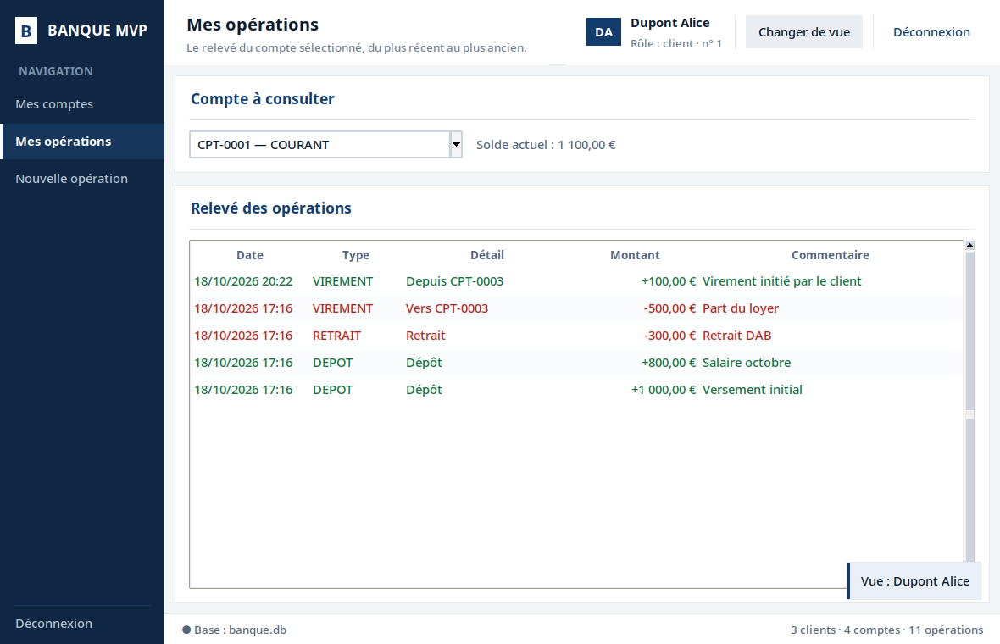
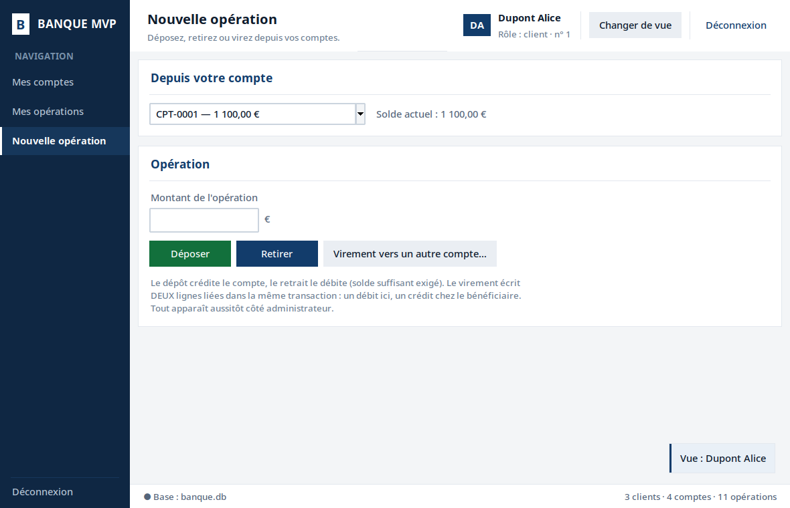

# Banque MVP — Système d'information bancaire

Application de gestion bancaire (clients, comptes, dépôts, retraits,
virements) en **Python 3.10+** avec **SQLite** (données) et **Tkinter**
(interface), organisée selon une **architecture en 3 couches** et les
concepts des systèmes d'information : trois sous-systèmes distincts
(données, traitements, interface), échangeant uniquement par des
interfaces contractuelles (DAO → Service → Vues).

---

## 1. Prise en main

```bash
./lancer.sh                                 # application (rendu optimal)
python main.py                              # équivalent direct
python -m unittest discover -s tests -v     # 66 tests unitaires
```

Au premier lancement, la base `banque.db` est créée puis peuplée
automatiquement par le scénario de démonstration : 3 clients (dont 1
suspendu), 4 comptes (dont 1 clôturé), une dizaine d'opérations
couvrant les 3 types, **dont un virement complet à deux jambes**
pour observer la double écriture dans le relevé.

L'application n'a **aucune dépendance externe** : uniquement la
bibliothèque standard (`sqlite3`, `tkinter`, `unittest`, `uuid`,
`dataclasses`).

---

## 2. Architecture — les 3 sous-systèmes

```
┌──────────────── Rôle 3 : INTERFACE ────────────────┐
│ app/ui/*.py + main.py                              │
│ saisie · arbres · dashboard · boîtes d'erreur      │
└───────────────────────┬────────────────────────────┘
                        │ appels de façade (méthodes métier)
┌──────────────── Rôle 2 : TRAITEMENTS ──────────────┐
│ app/services/bank_service.py   règles de gestion   │
│ app/services/exceptions.py     acide métier nommé  │
│ app/models/models.py           dataclasses         │
└───────────────────────┬────────────────────────────┘
                        │ appels DAO (dataclasses)
┌──────────────── Rôle 1 : DONNÉES ──────────────────┐
│ app/db/schema.sql  ·  db_manager.py  ·  seed.py    │
│ app/dao/* (SQL 100% paramétré)                     │
└────────────────────────────────────────────────────┘
```

| Rôle | Fichiers | Responsabilité exclusive |
| :--- | :--- | :--- |
| **1 — Données** | `app/db/*`, `app/dao/*` | Persistance, contraintes SQL, transactions |
| **2 — Traitements** | `app/models/*`, `app/services/*` | Règles de gestion, invariants, atomicité |
| **3 — Interface** | `app/ui/*`, `main.py` | Saisie validée, visualisation, messages |

Principe directeur du découplage : `main.py` n'exécute jamais de SQL ;
un DAO ne connaît aucune règle métier ; `bank_service.py` n'importe
jamais tkinter.

---

## 3. Section rapport 1 — Schéma et contraintes d'intégrité

`app/db/schema.sql` contient 3 tables et 1 index :

| Contrainte | Justification (concepts SI) |
| :--- | :--- |
| `client.cin UNIQUE` | Une pièce d'identité désigne une personne unique : règle légale |
| `CHECK (statut IN ('ACTIF','SUSPENDU'))` | Domaine de valeurs : aucun état hors référentiel |
| `compte.id_client REFERENCES client` | Intégrité référentielle : aucun compte orphelin |
| `compte.numero UNIQUE` | Identifiant fonctionnel : jamais deux numéros identiques |
| `CHECK (solde >= 0)` | **Invariant bancaire** ; la base est le dernier rempart derrière le service |
| `CHECK (type IN ('COURANT','EPARGNE'))` | Domaine de valeurs |
| `operation.montant > 0` | Le sens du mouvement (+/−) appartient au `type`, jamais à un signe |
| `operation.id_virement` | Uuid regroupant les **2 jambes** d'un même virement (traçabilité) |
| `index idx_op_compte` | L'accès le plus fréquent du SI est l'historique par compte |

Limite assumée (documentée) : `REAL` plutôt que décimal exact — un vrai
SI bancaire compterait en **centimes entiers**.

---

## 4. Section rapport 2 — Règles métier et atomicité

Toutes les règles vivent dans `BankService` (source de vérité unique) :

1. **R1 Validation** : nom/prénom/CIN requis, email vérifié, montants strictement positifs.
2. **R2 Solde ≥ 0** : tout retrait et tout virement sont refusés **avant** écriture (`SoldeInsuffisantError`).
3. **R3 Compte clôturé** : plus aucune opération (`CompteClotureError`).
4. **R4 Client suspendu** : ouverture de compte et opérations refusées (`ClientSuspenduError`).
5. **R5 Clôture à solde nul** : aucun compte clôturé ne doit pas être vide (`CompteNonVideError`).
6. **R6 Suppression protégée** : client possédant des comptes non supprimable (`ClientAComptesError`) — l'historique d'un SI ne perd jamais son titulaire.

### Écriture double atomique (cœur du SI)

`BankService.virement(id_source, id_cible, montant)` :

```python
with self._db.transaction():            # transaction racine : COMMIT ou ROLLBACK
    source = self._compte_operable(id_source)   # R2 + R3 + R4 vérifiés
    cible  = self._compte_operable(id_cible)
    if source.solde < montant:
        raise SoldeInsuffisantError(...)            # -> ROLLBACK intégral
    ref = str(uuid.uuid4())
    self._comptes.update_solde(source.id_compte, source.solde - montant)
    self._comptes.update_solde(cible.id_compte,  cible.solde + montant)
    self._operations.create(leg_debit)              # 2 jambes, un même id_virement
    self._operations.create(leg_credit)
```

- **Atomicité (ACID)** : deux UPDATE de solde + deux INSERT dans le même
  `with` — si la seconde jambe échoue, la première est annulée.
- `DatabaseManager.transaction()` accepte l'imbrication : un DAO appelé
  à l'intérieur **rejoint** la transaction (aucun commit intermédiaire) ;
  seul le niveau racine valide l'ensemble.

Preuve par le test `test_atomicite_une_jambe_fait_echouer_le_tout`
(`tests/test_bank_service.py`) : une panne est simulée au moment du
crédit cible ; le débit déjà appliqué est **annulé** — les soldes et
l'historique restent parfaitement cohérents.

---

## 5. Section rapport 3 — Interface et choix UX

- **Système de design centralisé** (`app/ui/theme.py`) : direction
  « flat institutionnel » — aplats, filets de 1 px, **zéro arrondi ni
  dégradé** ; moteur `clam` ; familles de polices détectées à chaud
  (`Segoe UI` → `Inter` → `Noto Sans` → `Cantarell` → `Liberation
  Sans` → `Ubuntu` → `DejaVu Sans`), détection **insensible à la
  casse** — sans quoi Tk retombe sur sa police bitmap « fixed »
  illisible ; `lancer.sh` préfère l'interpréteur au rendu lissé
  (fontconfig).
- **Coquille applicative** (`app/ui/shell.py`) : barre latérale de
  navigation, en-tête (titre de page + utilisateur + bouton « Changer
  de vue »), barre d'état (base + compteurs en direct), routage
  paresseux des écrans et raccourcis clavier (`Ctrl+1..9`, `F5`).
- **Deux espaces, une seule base** (`app/ui/session.py`) : espace
  **Administrateur** (4 écrans de gestion) et espace **Client** (ses
  comptes, son relevé, ses opérations) ; bascule à chaud, registre de
  navigation filtré par rôle (`EntreeNav.roles`) ; une opération
  saisie côté client apparaît côté admin dès la bascule — c'est le
  scénario de démonstration.
- **Écrans disponibles** :
  | Espace | Écran | Contenu |
  | :--- | :--- | :--- |
  | Admin | Tableau de bord | Indicateurs (clients, comptes actifs, encours, volume) + 10 derniers mouvements |
  | Admin | Clients | CRUD complet : fiche de saisie + tableau, CIN unique, statuts |
  | Admin | Comptes | Filtre par titulaire, ouverture (type + solde initial), clôture protégée |
  | Admin | Opérations | Dépôt / Retrait / Virement + relevé signé et coloré |
  | Client | Mes comptes | KPI (comptes actifs, encours) + tableau des comptes du client |
  | Client | Mes opérations | Relevé du compte choisi : « Vers/Depuis CPT-xxxx », signes et couleurs |
  | Client | Nouvelle opération | Déposer, retirer, virer (bénéficiaire par n° de compte, erreurs inline) |
- **Kit de composants réutilisables** (`app/ui/components/`) : cartes
  (dont cartes KPI), tableaux zébrés (survol + état vide), champs à
  erreur inline (dont champ montant), badges d'état, modales et
  notifications *toast*, histogramme Canvas, zone défilante.
- **Bus d'événements** (`base_view.py`) : après chaque modification de
  la base, les vues construites **et** la barre d'état se
  re-synchronisent (pattern observateur/observé).
- **Mapping des exceptions** : chaque `ErreurMetier` est convertie en
  message compréhensible — l'utilisateur ne voit jamais une trace
  technique.
- Le relevé distingue les jambes d'un virement : « vers CPT-0002 » /
  « depuis CPT-0002 », montant signé et coloré (vert/rouge).
- **Détail complet — fichier par fichier, fonction par fonction :
  `docs/interface.md`** (documentation technique de l'interface).

Captures d'écran (espace administrateur) :







Espace client (bascule « Changer de vue ») :





---

## 6. Structure du projet

```
Banking_System_Management/
├── main.py                     # assemblage : données → métier → interface
├── requirements.txt            # stdlib uniquement (aucune dépendance)
├── README.md                   # ce rapport
├── app/
│   ├── db/
│   │   ├── schema.sql          # DDL : 3 tables, CHECK/UNIQUE/FK/index
│   │   ├── db_manager.py       # connexion, schéma, transactions imbriquables
│   │   └── seed.py             # scénario de démonstration
│   ├── dao/
│   │   ├── client_dao.py       # CRUD client
│   │   ├── compte_dao.py       # CRUD compte + update_solde + numéro CPT-000x
│   │   └── operation_dao.py    # create / history / legs_of_virement
│   ├── models/
│   │   └── models.py           # Client / Compte / Operation (dataclasses)
│   ├── services/
│   │   ├── exceptions.py       # ErreurMetier + 9 exceptions spécialisées
│   │   └── bank_service.py     # toutes les règles de gestion
│   └── ui/
│       ├── theme.py            # charte : jetons, polices, styles ttk
│       ├── format.py           # montants, dates, saisie numérique
│       ├── utilitaires.py      # liaisons récursives, centrage fenêtre
│       ├── base_view.py        # bus d'événements + VueBase
│       ├── session.py          # espaces Admin/Client + sélecteur de vue
│       ├── shell.py            # barre latérale + en-tête + routeur
│       ├── components/         # kit : cartes, tableaux, champs, retours…
│       │   ├── cartes.py       # Carte, CarteKPI
│       │   ├── tableaux.py     # Tableau (Treeview habillé)
│       │   ├── champs.py       # Champ, ChampMontant, Badge
│       │   ├── retours.py      # Modale, Confirmation, toasts
│       │   ├── graphiques.py   # GraphiqueBarres (Canvas)
│       │   └── defilement.py   # ZoneDefilante (molette Linux)
│       ├── dashboard_view.py   # écran admin 1
│       ├── clients_view.py     # écran admin 2
│       ├── comptes_view.py     # écran admin 3
│       ├── operations_view.py  # écran admin 4
│       ├── mes_comptes_view.py        # écran client 1
│       ├── mes_operations_view.py     # écran client 2
│       └── nouvelle_operation_view.py # écran client 3
├── docs/
│   └── interface.md            # rapport 3 : chaque fichier, chaque fonction
└── tests/
    ├── conftest.py             # base SQLite éphémère par test
    ├── test_dao.py             # CRUD + contraintes SQL (16 tests)
    ├── test_bank_service.py    # règles métier + atomicité (29 tests)
    └── test_formats.py         # formatage UI + relecture montants (21 tests)
```

---

## 7. Limites connues et positions d'ingénierie

| Sujet | Position |
| :--- | :--- |
| Monnaie | `REAL` (float) pour ce MVP ; un SI de production compterait en centimes entiers |
| Concurrence | SQLite et connexion unique : application bureautique mono-utilisateur |
| Tests | `unittest` stdlib, base éphémère, aucune dépendance externe |
| Seed | Uniquement si `banque.db` est absente à l'ouverture ; `seed_demo_data` est un no-op sur une base déjà peuplée |

---

Built by Rayan Akioud, Mohamed Rayan Htalal and Ahmed Marouan — ENSAM students, 2026
